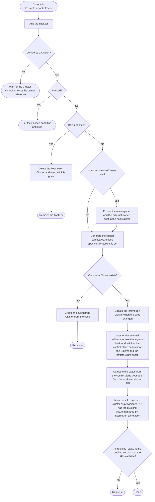
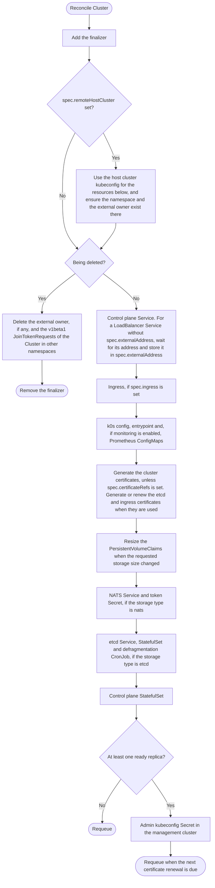
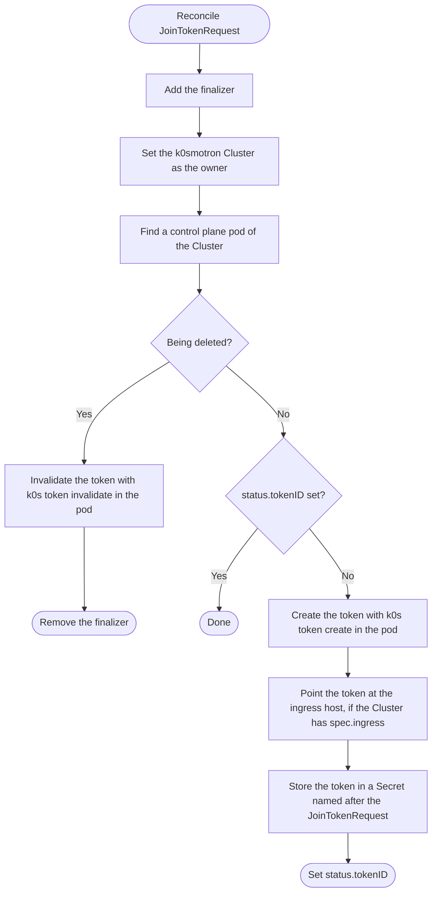
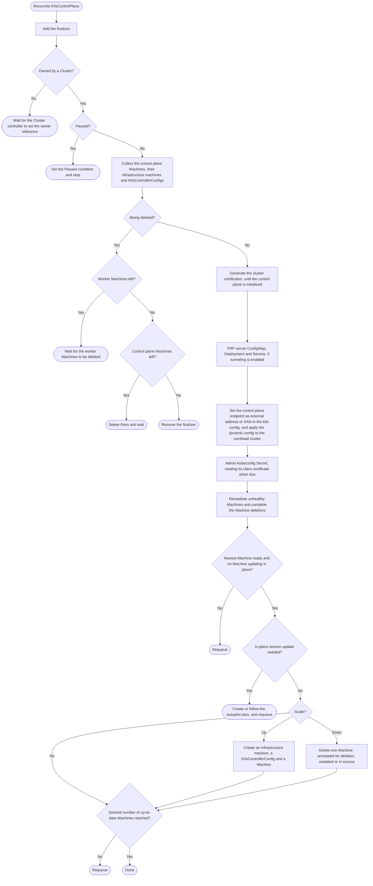
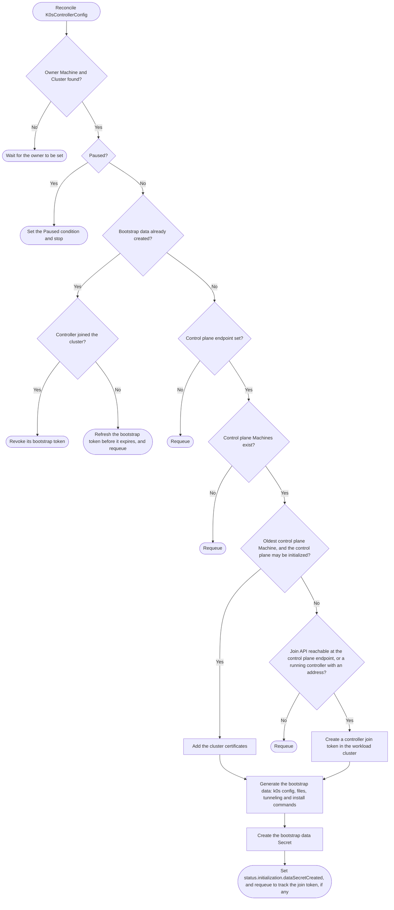
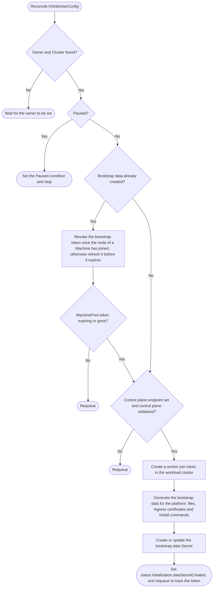
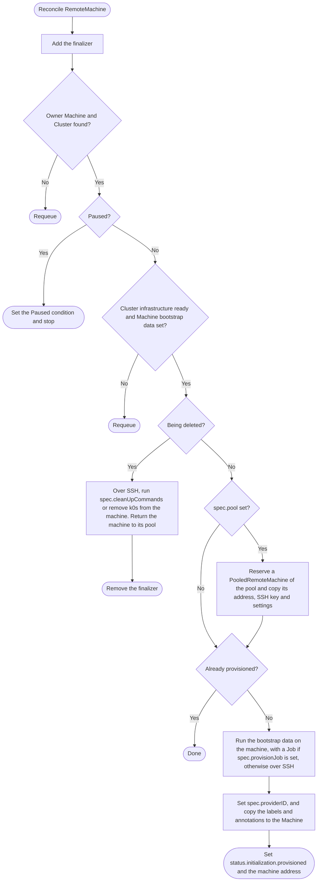

# Reconciliation workflows

This page describes how the k0smotron controllers reconcile each resource, in the style of the
[Cluster API provider contracts](https://cluster-api.sigs.k8s.io/developer/providers/contracts/infra-cluster.html#typical-infracluster-reconciliation-workflow).
It helps to understand in which order things happen, what a resource waits for, and where to look when a
resource does not make progress.

The diagrams show the main path of a reconcile. Some details are left out to keep them readable:

- An error at any step ends the reconcile, and the controller retries it later with a backoff.
- Most steps also set a condition on the resource, so `kubectl describe` usually tells which step a resource is waiting at.
- The Cluster API resources follow the Cluster API contract for paused clusters: while the `Cluster` or the resource
  is paused, the controller only sets the `Paused` condition and does nothing else.

The names of the resources that the controllers create are listed in [Generated Resources](generated-resources.md).

## Hosted control planes

A hosted control plane is reconciled by two controllers. The `K0smotronControlPlane` controller translates the
Cluster API resource to a `k0smotron.io` `Cluster` and reports its state back to Cluster API, and the `Cluster`
controller creates the control plane pods and the resources around them.

### K0smotronControlPlane

### Cluster (k0smotron.io)

The `Cluster` controller is also used without Cluster API, to [create a cluster in standalone mode](cluster.md).
With `spec.remoteHostCluster`, the controller creates its resources in the host cluster, except the admin kubeconfig
Secret, which is always created in the management cluster. In the host cluster, the resources are owned by an external
owner ConfigMap, so that deleting the external owner removes all of them.

The etcd StatefulSet is scaled up one member at a time. A member is only added once every current member is ready.

### JoinTokenRequest

## Control planes on machines

### K0sControlPlane

After every reconcile, the controller updates the status of the `K0sControlPlane`, and once the control plane is
initialized also the `Cluster`, from the Machines and from the workload cluster API.

## Bootstrap providers

Both bootstrap providers generate the bootstrap data of a Machine once. After that, they only keep track of the
bootstrap token embedded in it.

### K0sControllerConfig

The control plane may be initialized while the `Cluster` does not have the `ControlPlaneInitialized` condition yet,
or when it stores its data in kine or an external etcd cluster. A controller has joined when its Machine has a node
reference or, for a controller without a worker, when the workload cluster has a `ControlNode` for it.

### K0sWorkerConfig

### Machine provider ID

k0smotron also sets the provider ID of the nodes. This applies to every `Machine` that is bootstrapped by a
`K0sWorkerConfig`, or by a `K0sControllerConfig` with the worker enabled, and to every `Machine` backed by a
`RemoteMachine`. Once the `Machine` has a `spec.providerID`, the controller finds its node in the workload cluster, by
name, `k0smotron.io/machine-name` label or address, and sets the provider ID of the `Machine` on the node.

## Infrastructure provider

### RemoteCluster

A `RemoteCluster` has nothing to provision. Once it is owned by a `Cluster`, the controller marks it as provisioned
and sets its `Ready` condition. Its `spec.controlPlaneEndpoint` is either set by the user or, for a hosted control
plane, by the `K0smotronControlPlane` controller.

### RemoteMachine

