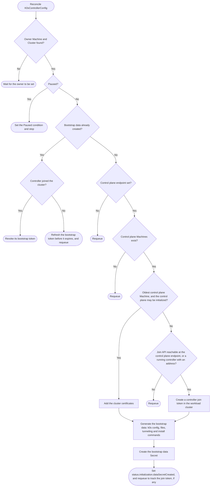

# K0sControllerConfig reconciliation workflow

The control plane may be initialized while the `Cluster` does not have the `ControlPlaneInitialized` condition yet,
or when it stores its data in kine or an external etcd cluster. A controller has joined when its Machine has a node
reference or, for a controller without a worker, when the workload cluster has a `ControlNode` for it.
