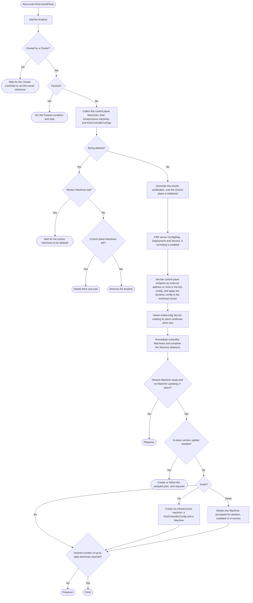

# K0sControlPlane reconciliation workflow

After every reconcile, the controller updates the status of the `K0sControlPlane`, and once the control plane is
initialized also the `Cluster`, from the Machines and from the workload cluster API.
