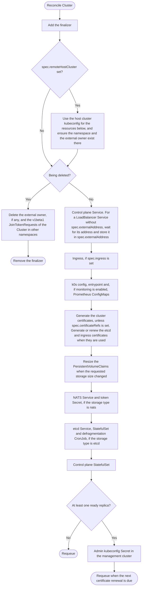

# Cluster (k0smotron.io) reconciliation workflow

The `Cluster` controller is also used without Cluster API, to [create a cluster in standalone mode](../cluster.md).
With `spec.remoteHostCluster`, the controller creates its resources in the host cluster, except the admin kubeconfig
Secret, which is always created in the management cluster. In the host cluster, the resources are owned by an external
owner ConfigMap, so that deleting the external owner removes all of them.

The etcd StatefulSet is scaled up one member at a time. A member is only added once every current member is ready.
